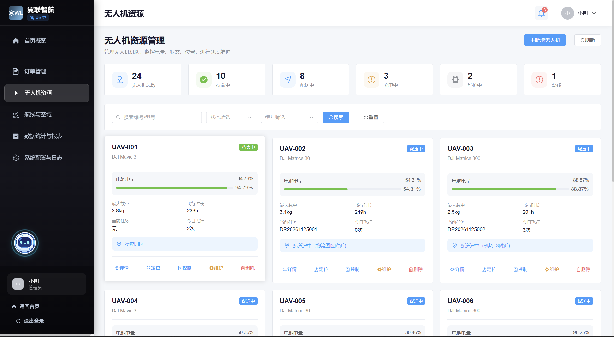
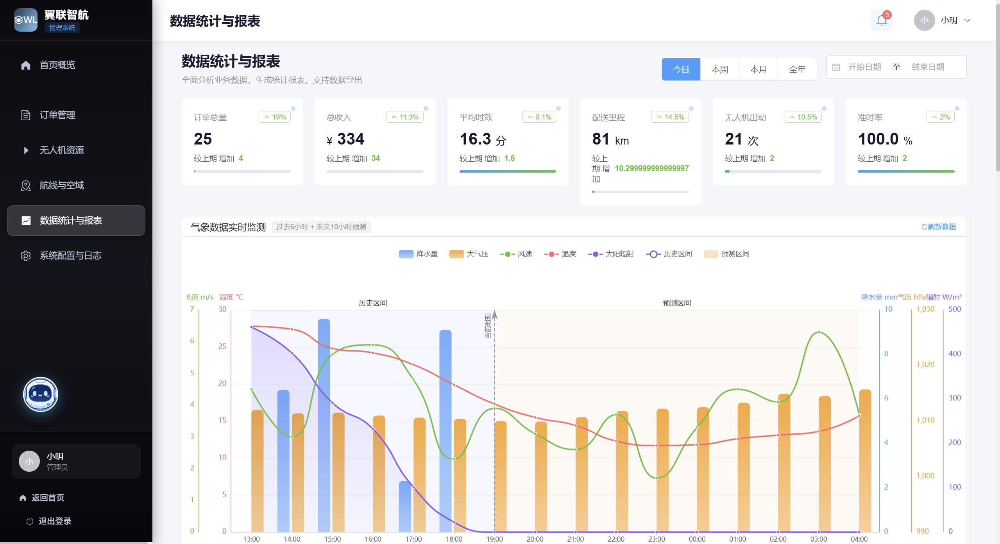

# 翼联智航 · 无人机配送协同平台

以城市低空配送为场景的 Web 项目，包含配送门户和运营后台。后台用模拟订单和机队数据展示派单、配送进度、航线与运营统计，后端提供 Spring Boot REST 接口。

**技术栈**　Vue 3 · Pinia · Element Plus · ECharts · Java 17 · Spring Boot 3.2 · MyBatis-Plus · MySQL

[在线门户演示](https://statuesque-phoenix-9ff3be.netlify.app/) · [门户截图](winglink-drone/docs/images/portal-home.png) · [本地运行](winglink-drone/README.md)

在线地址提供静态门户。后台可在本地体验，截图和页面上的配送量、准时率及机队状态均为演示数据。项目未接入真实无人机或飞控系统。

## 主要功能

- **模拟派单**。从空闲无人机中按到发货点的距离推荐无人机，距离相同时优先选电量较高的无人机。订单管理页定时推进配送进度，联动更新订单状态和机队位置。演示状态由 Pinia 管理并保存在浏览器中。详见 [调度状态与规则](winglink-drone/drone-web/drone-web/src/store/dashboard.js)。
- **运营后台**。按状态和区域筛选订单，查看机队状态、电量与当前位置，在航线页查看航线和轨迹演示。报表使用 ECharts 展示订单趋势和区域分布。
- **业务接口**。Spring Boot 实现账号注册、登录校验和 JWT 签发，以及订单创建、筛选、取消、恢复与费用估算。MyBatis-Plus 连接 MySQL，后端另提供机队查询与订单聚合统计。当前后台页面使用模拟登录，调度与报表的主要展示数据来自前端。详见 [后端接口](winglink-drone/drone-admin/src/main/java/com/winglink/controller)。

## 后台界面

**无人机资源** · 查看机队状态、电量和配送任务。

**数据统计与报表** · 查看订单趋势、区域分布和运营指标。

## 源码入口

| 模块 | 路径 |
| --- | --- |
| Vue 前端 | [`winglink-drone/drone-web/drone-web`](winglink-drone/drone-web/drone-web) |
| Spring Boot 后端 | [`winglink-drone/drone-admin`](winglink-drone/drone-admin) |
| 数据库表结构 | [`winglink-drone/database.example.sql`](winglink-drone/database.example.sql) |
